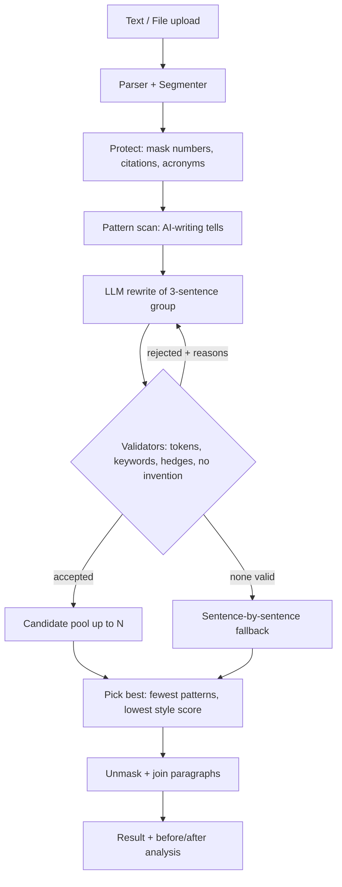

# Ai-Humanizer

   

An editing and readability tool for English text (especially scientific articles) that preserves meaning, numbers, citations and technical terms.
It is meant for editing and clarity and **makes no guarantee about AI-detector results**.

## Contents
- [Overview](#overview) · [Architecture](#architecture) · [Repo Structure](#repo-structure) · [Getting Started](#getting-started) · [Configuration](#configuration) · [Pipeline](#pipeline) · [Usage](#usage) · [Known Issues](#known-issues) · [Roadmap](#roadmap) · [Contributing](#contributing) · [License](#license)

## Overview
Text or file → split into paragraphs and 3-sentence groups → rewrite with a local LLM → fidelity validation → best of 3 candidates → output.
Features: styles (academic / practical / light / casual), writing-sample style matching, explained detection of machine-like writing patterns, job queue, quotas, Google sign-in, privacy cleanup.

## Architecture


## Repo Structure
```
backend/app/  main.py auth.py db.py jobs.py files.py config.py
              rewriter.py prompts.py protect.py validate.py patterns.py analyzer.py llm.py
backend/tests/ test_api.py test_core.py
frontend/app/  page.tsx  app/page.tsx
```

## Getting Started (Windows)
```
cd backend
python -m venv .venv
.venv\Scripts\activate
pip install -r requirements.txt
copy .env.example .env
ollama pull qwen2.5:14b-instruct
uvicorn app.main:app --port 8000
```
In a second terminal:
```
cd frontend
npm install
npm run dev
```
Then open `http://localhost:3000` (with `DEV_LOGIN=true`, use `/auth/dev-login`).

## Configuration
`SECRET_KEY, PUBLIC_URL, DATABASE_URL, GOOGLE_CLIENT_ID/SECRET, DEV_LOGIN, ADMIN_EMAILS, ALLOWED_EMAIL_DOMAINS, LLM_URL, LLM_API_KEY, LLM_MODEL, LLM_TIMEOUT, MAX_PASSES, CANDIDATES, TARGET_SCORE, MAX_WORDS_PER_JOB, DAILY_WORD_LIMIT, WORKER_CONCURRENCY, RESULT_RETENTION_HOURS`
- On CPU, the 7B model is faster and the 14B model gives better quality. For a Colab GPU, only change `LLM_URL`.

## Pipeline
1. Protect numbers, citations and acronyms.
2. Rewrite each 3-sentence group.
3. Validate (tokens, keywords, hedges, no invented sentences).
4. Feed rejection reasons into the next attempt.
5. Pick the best candidate.
6. Sentence-by-sentence fallback; only rejected sentences keep the original.

## Usage
Sign in → paste text (min. 30 words) or upload a file → choose a style (Light for scientific text) → follow progress → view the result and detected patterns.

## Known Issues
- Slow on CPU (a long article can take hours).
- The analyzer score is an internal style signal, not a detector metric.
- No diff view yet.

## Roadmap
- [x] Job queue, quotas, pattern detection, validation
- [x] Group rewriting + best-of-N + partial fallback
- [ ] Diff view · Colab guide · Postgres · payments

## Contributing
Small commits, one phase at a time; run `python -m pytest -q` before opening a PR.

## License
MIT
