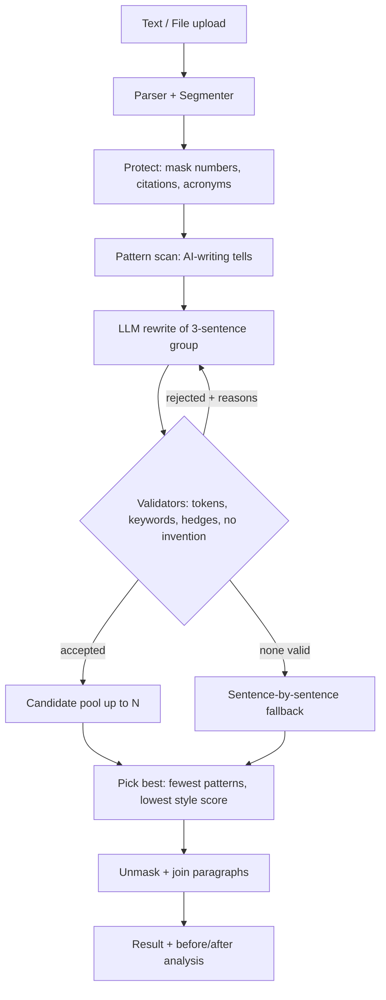

# Ai-Humanizer

   

ابزار ویرایش و روان‌سازی متن انگلیسی (مقاله‌های علمی) با حفظ دقیق معنا، اعداد، ارجاعات و اصطلاحات تخصصی.
این ابزار برای ویرایش و بهبود خوانایی است و **هیچ تضمینی برای عبور از آشکارسازها نمی‌دهد**.

## فهرست
- [Overview](#overview) · [Architecture](#architecture) · [Repo Structure](#repo-structure) · [Getting Started](#getting-started) · [Configuration](#configuration) · [Pipeline](#pipeline) · [Usage](#usage) · [Known Issues](#known-issues) · [Roadmap](#roadmap) · [Contributing](#contributing) · [License](#license)

## Overview
متن یا فایل → تقسیم به پاراگراف و گروه‌های ۳ جمله‌ای → بازنویسی با LLM محلی → اعتبارسنجی وفاداری → انتخاب بهترین از ۳ کاندیدا → خروجی.
ویژگی‌ها: سبک‌ها (academic / practical / light / casual)، نمونهٔ نوشتار برای تقلید لحن، تشخیص الگوهای نوشتار ماشینی با توضیح، صف کار، سهمیه، ورود با گوگل، پاک‌سازی حریم خصوصی.

## Architecture


## Repo Structure
```
backend/app/  main.py auth.py db.py jobs.py files.py config.py
              rewriter.py prompts.py protect.py validate.py patterns.py analyzer.py llm.py
backend/tests/ test_api.py test_core.py
frontend/app/  page.tsx  app/page.tsx
```

## Getting Started (Windows)
```
cd backend
python -m venv .venv
.venv\Scripts\activate
pip install -r requirements.txt
copy .env.example .env
ollama pull qwen2.5:14b-instruct
uvicorn app.main:app --port 8000
```
در ترمینال دوم:
```
cd frontend
npm install
npm run dev
```
سپس `http://localhost:3000` (با `DEV_LOGIN=true` آدرس `/auth/dev-login`).

## Configuration
`SECRET_KEY, PUBLIC_URL, DATABASE_URL, GOOGLE_CLIENT_ID/SECRET, DEV_LOGIN, ADMIN_EMAILS, ALLOWED_EMAIL_DOMAINS, LLM_URL, LLM_API_KEY, LLM_MODEL, LLM_TIMEOUT, MAX_PASSES, CANDIDATES, TARGET_SCORE, MAX_WORDS_PER_JOB, DAILY_WORD_LIMIT, WORKER_CONCURRENCY, RESULT_RETENTION_HOURS`
- روی CPU مدل ۷B سریع‌تر و ۱۴B با کیفیت‌تر است. برای GPU کولب فقط `LLM_URL` را عوض کنید.

## Pipeline
۱) محافظت از اعداد/ارجاع/اختصارها ۲) بازنویسی گروه ۳ جمله‌ای ۳) اعتبارسنجی (توکن‌ها، کلیدواژه‌ها، hedgeها، جملهٔ ساختگی) ۴) بازخورد دلیل رد به تلاش بعدی ۵) انتخاب بهترین کاندیدا ۶) fallback جمله‌به‌جمله؛ فقط جملات ردشده اصلی می‌مانند.

## Usage
ورود → چسباندن متن (حداقل ۳۰ کلمه) یا آپلود فایل → انتخاب سبک (برای متن علمی: Light) → پیگیری پیشرفت → مشاهدهٔ نتیجه و الگوهای یافت‌شده.

## Known Issues
- روی CPU پردازش کند است (مقالهٔ بلند = چند ساعت).
- امتیاز تحلیلگر سیگنال داخلی است، نه معیار آشکارسازها.
- هنوز diff view ندارد.

## Roadmap
- [x] صف کار، سهمیه، الگوهای ماشینی، اعتبارسنجی
- [x] بازنویسی گروهی + best-of-N + fallback جزئی
- [ ] Diff view · راهنمای Colab · Postgres · پرداخت

## Contributing
Commitهای کوچک، هر مرحله جدا؛ قبل از PR اجرای `python -m pytest -q`.

## License
MIT
